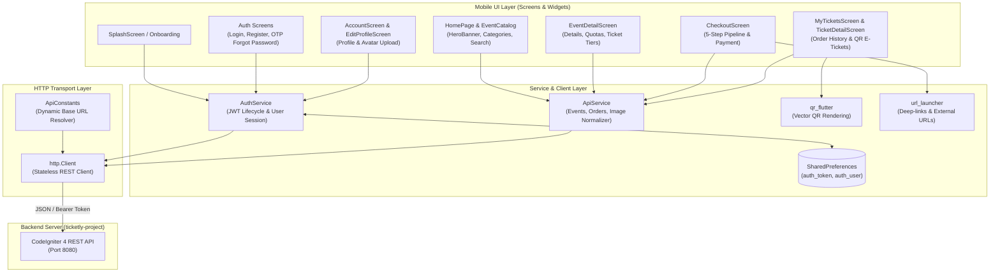

<p align="center">
  
</p>

# Ticketly Mobile Client

**Cross-platform mobile ticketing client built with Flutter and Dart, connecting to the Ticketly RESTful API for event browsing, multi-attendee checkout, Midtrans payments, and dynamic QR e-tickets.**

---

[](https://flutter.dev)
[](https://dart.dev)
[](pubspec.yaml)
[](https://pub.dev/packages/shared_preferences)
[](https://pub.dev/packages/qr_flutter)
[](https://github.com/pratama1246/ticketly-project)
[](LICENSE)

---

## Quickstart

Get the mobile application running on an emulator or physical device:

```bash
# 1. Clone repository & enter directory
git clone https://github.com/pratama1246/ticketly.git
cd ticketly

# 2. Fetch Flutter packages
flutter pub get

# 3. Verify connected target devices
flutter devices

# 4. Launch the application
flutter run
```

*Note: Ensure the backend API server is running on port 8080 ([ticketly-project](https://github.com/pratama1246/ticketly-project)).*

---

## Table of Contents

- [Application Overview](#application-overview)
- [Practical Use Cases](#practical-use-cases)
- [Core Engineering Capabilities](#core-engineering-capabilities)
- [System & Data Architecture](#system--data-architecture)
- [Directory Structure](#directory-structure)
- [Network & Device Configuration](#network--device-configuration)
- [Backend API Integration Contract](#backend-api-integration-contract)
- [How to Build & Package](#how-to-build--package)
- [Default Testing Accounts](#default-testing-accounts)
- [License & Disclaimer](#license--disclaimer)

---

## Application Overview

Ticketly Mobile is the client application for the Ticketly event platform, built using **Flutter (Dart 3.x)**. It provides event discovery, ticket category reservation, attendee registration, and ticket wallet management for eventgoers on mobile platforms (Android and iOS) as well as desktop and web browsers.

The client communicates with the **Ticketly CodeIgniter 4 RESTful API** using stateless HTTP requests authenticated via custom JSON Web Tokens (JWT). All authentication tokens and user profiles are stored locally using `shared_preferences`.

The application includes a complete 5-step checkout pipeline supporting Midtrans Core API direct payment rails (Virtual Accounts, QRIS, and E-Wallets), automatic URL normalization across network topologies (emulators, local Wi-Fi, and production tunnels), and client-side vector QR code rendering for on-site gate check-in scanning.

---

## Practical Use Cases

| Scenario | Problem Solved | Realized Benefit |
|---|---|---|
| **High-Demand Ticket Drops** | Network dropouts and stale quota counts causing checkout failures. | Real-time cart calculation and inventory checks lock tickets on the backend while displaying countdown timers to the buyer. |
| **Multi-Attendee Group Purchases** | Group bookings requiring separate identification data per attendee for venue compliance. | Dynamic multi-attendee form steps capture individual attendee names, emails, and identity numbers (NIK) mapped directly to each purchased ticket tier. |
| **Direct Payment Settlement** | Clunky external browser redirects confusing users during mobile payments. | Native payment review displays copyable Virtual Account numbers, renders scannable QRIS codes directly on-screen, and triggers app deep-links for e-wallets. |
| **Gate Check-in Entry** | Poor internet connectivity at event venues delaying ticket retrieval. | Cached order items generate crisp, on-device vector QR codes via `qr_flutter` with seat allocation details ready for gate check-in scanners. |
| **Self-Service Credential Recovery** | Forgotten user passwords preventing mobile access. | In-app 6-digit OTP verification flow allows instant password resets directly from the mobile login screen without administrative intervention. |

---

## Core Engineering Capabilities

### 1. Dynamic Network Authority Normalization
- Centralized URL authority rewrites in `ApiService::normalizeImageUrl`:
  Replaces localhost backend image URLs on the fly with the active device host (e.g., `10.0.2.2` for Android emulator, LAN IP for Wi-Fi devices) to prevent broken poster images across different execution environments.

### 2. Multi-Step Checkout Pipeline
- **Step 1 (Terms & Conditions)**: UU PDP data consent and ticket policy agreement.
- **Step 2 (Attendee Registration)**: Captures individual attendee credentials per ticket item (attendee name, email, identity number).
- **Step 3 (Payment Selection)**: Dynamic list of Midtrans Core API rails (BCA, BNI, BRI, Permata, Mandiri Bill, GoPay, ShopeePay, QRIS, Akulaku).
- **Step 4 (Order Review & Vouchers)**: Real-time promo voucher validation and discount subtotal recalculation.
- **Step 5 (Billing & Settlement)**: Live settlement screen featuring real-time expiry countdown, one-tap Virtual Account copy, on-screen QRIS vector generation, and deep-link triggers via `url_launcher`.

### 3. Local Session & JWT Token Lifecycle
- Stateless token storage managed by `AuthService` using `shared_preferences`.
- Automatically injects `Authorization: Bearer <token>` into protected requests (`/api/profile`, `/api/orders`, `/api/checkout/start`, `/api/auth/logout`).
- Immediate local cache clearance upon session invalidation or user logout.

### 4. Vector E-Ticket Generation
- Direct rendering of high-resolution QR codes via `qr_flutter` using the unique encrypted ticket code issued by the backend order system.
- Displays ticket tier, event date, venue, seat assignments, and attendee identity metadata for physical venue gate validation.

---

## System & Data Architecture



---

## Directory Structure

```text
ticketly/
├── assets/                     # Application static resources
│   ├── icons/                  # Vector SVG assets (e.g., google.svg)
│   └── images/                 # Brand logos, onboarding graphics, and illustrations
├── lib/                        # Core application source code
│   ├── constants/              # Global paths & dynamic API base URL resolver (api_constants.dart)
│   ├── data/                   # Client-side static catalog data
│   ├── extensions/             # Dart & Flutter utility extensions
│   ├── models/                 # Data transfer objects (EventModel, EventDetailModel, OrderDetailModel)
│   ├── providers/              # State management holders
│   ├── screens/                # UI screens and navigation views
│   │   ├── splash_screen.dart          # Initial launch & session check
│   │   ├── onboarding_screen.dart      # First-launch onboarding carousel
│   │   ├── login_screen.dart           # Authentication entry point
│   │   ├── register_screen.dart        # Customer account creation
│   │   ├── forgot_password_screen.dart # Email OTP request
│   │   ├── verification_screen.dart    # 6-digit OTP code verification
│   │   ├── new_password_screen.dart    # Password reset submission
│   │   ├── home_page.dart              # Main catalog & headline carousel
│   │   ├── event_detail_screen.dart    # Venue, seatmap, and ticket tiers
│   │   ├── checkout_screen.dart        # 5-step checkout & Midtrans payment
│   │   ├── my_tickets_screen.dart      # Transaction order history
│   │   ├── ticket_detail_screen.dart   # Vector QR code e-ticket
│   │   ├── account_screen.dart         # User profile summary
│   │   └── edit_profile_screen.dart    # Profile credential & photo update
│   ├── service/                # Business logic & HTTP integration (ApiService, AuthService)
│   ├── theme/                  # Global color palettes, dimensions, and typography styles
│   ├── utils/                  # Date formatting and helper utilities
│   ├── widgets/                # Reusable UI modules (HeroBanner, EventCard, BottomNavBar)
│   └── main.dart               # Flutter application entry point
├── pubspec.yaml                # Flutter dependencies & asset registrations
└── README.md                   # Mobile client documentation
```

---

## Network & Device Configuration

The application dynamically detects its operating environment to route requests to the correct backend host:

```dart
// lib/constants/api_constants.dart
static String get baseUrl {
  if (kIsWeb) {
    return 'http://localhost:8080';
  }
  if (Platform.isAndroid) {
    // Android Emulator host loopback address
    return 'http://10.0.2.2:8080';
    // For Physical Android device via local Wi-Fi, change to your LAN IP:
    // return 'http://192.168.x.x:8080';
  }
  return 'http://localhost:8080'; // iOS Simulator or macOS / Windows Desktop
}
```

### Physical Device via USB (Port Reverse)

If running on a physical Android device connected via USB with ADB debugging enabled, you can proxy localhost port 8080 without changing source code:

```bash
adb reverse tcp:8080 tcp:8080
```

---

## Backend API Integration Contract

The mobile client consumes endpoints provided by the [Ticketly Backend (CodeIgniter 4)](https://github.com/pratama1246/ticketly-project):

### Core API Endpoints Consumed

| Endpoint | Auth | Purpose |
|---|---|---|
| `POST /api/auth/register` | Public | Account creation |
| `POST /api/auth/login` | Public | JWT token issuance |
| `POST /api/auth/logout` | JWT | Session termination & token revocation |
| `POST /api/auth/forgot-password` | Public | Send Bcrypt OTP reset code via email |
| `POST /api/auth/verify-code` | Public | Verify 6-digit OTP code |
| `POST /api/auth/reset-password` | Public | Set new password with verified OTP |
| `GET /api/events/landing` | Public | Aggregated landing page payload |
| `GET /api/events/featured` | Public | Headline banner events |
| `GET /api/events/{slug}` | Public | Full event details & venue seatmap |
| `GET /api/events/{id}/tickets` | Public | Ticket tiers with real-time remaining quota |
| `GET /api/vouchers/active` | Public | Fetch active promo vouchers |
| `POST /api/checkout/calculate` | Public | Compute subtotal, fees, and discounts |
| `GET /api/checkout/payment-methods` | Public | Retrieve supported Midtrans payment rails |
| `POST /api/checkout/start` | JWT | Atomic stock lock & Midtrans charge creation |
| `POST /api/checkout/cancel` | JWT | Cancel booking transaction |
| `GET /api/profile` | JWT | Current user profile |
| `POST /api/profile/update` | JWT (Multipart) | Update user profile & avatar image |
| `GET /api/orders` | JWT | User transaction order history |
| `GET /api/orders/{id}` | JWT | Detailed transaction receipt with e-tickets |

*For complete endpoint schemas and live testing, access the interactive documentation at `http://localhost:8080/api/docs`.*

---

## How to Build & Package

### Run Debug Mode
```bash
flutter run
```

### Build Android APK (Release)
```bash
flutter build apk --release
# Output: build/app/outputs/flutter-apk/app-release.apk
```

### Build Android App Bundle (Play Store)
```bash
flutter build appbundle --release
# Output: build/app/outputs/bundle/release/app-release.aab
```

### Build Web Client
```bash
flutter build web --release
# Output: build/web/
```

---

## Default Testing Accounts

To log in and test features without creating a new user, ensure the backend database seeds have been executed and use:

| Role | Email | Password | Username |
|---|---|---|---|
| **Administrator** | `admin@ticketly.com` | `admin123` | `admin` |
| **Customer 1** | `budi@example.com` | `password123` | `budi_santoso` |
| **Customer 2** | `ani@example.com` | `password123` | `ani_wijaya` |
| **Customer 3** | `dewi@example.com` | `password123` | `dewi_sari` |

---

## License & Disclaimer

- **License**: Licensed under the [MIT License](LICENSE).
- **Academic Disclaimer**: This mobile application was developed for educational purposes at **Politeknik Negeri Cilacap**, Informatics Engineering Department. All event posters, trademarks, and promoter names belong to their respective copyright owners.

---

<p align="center">
  <sub>Maintained by <strong>pratama1246</strong> · Ticketly Mobile Client</sub>
</p>
